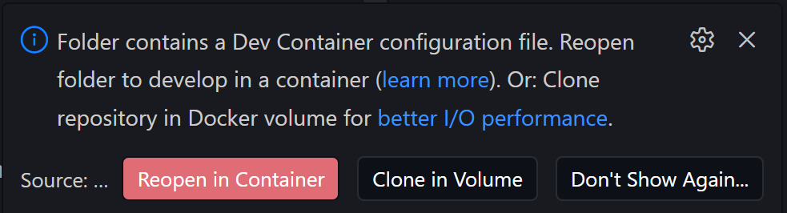

# MobiFlight Architecture

MobiFlight is a hybrid app:

- **C# backend** handles flight sim integration, hardware communication, and the execution engine
- **Frontend** provides the configuration UI. The frontend is a React + TypeScript app using Vite, Tailwind, and shadcn/ui. It runs inside a WebView2 control embedded in the C# backend window.
- Frontend and backend communicate through a JSON message bridge — the React side calls `PostMessage` and C# handles it via handlers in `BrowserMessages`.

The main backend subsystems are:

- **Execution engine** - reads variables from the flight simulator on a polling timer and applies user-defined mappings to drive output devices
- **Flight sim connectors** - separate integrations for MSFS (SimConnect), FSX/P3D (FSUIPC), and X-Plane
- **Hardware device drivers** - Arduino-based MobiFlight boards, Arcaze USB, MIDI boards, USB HID game controllers, and others
- **Browser message layer** - the IPC bridge between C# and the React UI

---

## Development Workflow

In development you run two things side by side:

- The frontend dev server in [Visual Studio Code](https://code.visualstudio.com/), inside the provided dev container
- The C# backend in [Visual Studio 2026](https://visualstudio.microsoft.com/vs/community/). When you start the backend with the **Debug** build target it connects to the frontend dev server at `localhost:5173` and loads it automatically.

To get started, clone the repository into a Windows folder of your choice, then set up the frontend and the backend as described below.

### Dev container setup

The easiest way to get started is with the included dev container — dependencies and Playwright browsers for unit tests are installed automatically on first startup.

1. [Follow the instructions](https://code.visualstudio.com/docs/devcontainers/tutorial) to install Docker and the Dev Containers extension in Visual Studio Code.
2. Select **Open Folder..** in VS Code, navigate to `src/MobiFlightConnector/frontend/`
3. When prompted by VSCode, select **Reopen in Container**



The first time takes a few minutes to configure while the necessary images are downloaded and dependencies install. After the container opens VSCode may warning about an auto-configured task to run. Accept the task, and the frontend will start.

The frontend is served at `http://localhost:5173`.

To manually start the frontend, use the command palette (CTRL+SHIFT+P) to select the **Tasks: Run Task** command, then run **Start frontend**.

### C#.NET Dev Environment (Backend)

The backend is a C#/.NET desktop application and it must be running for full functionality. Once your devcontainer has finished starting up, and the frontend is available at `localhost:5173`, open the backend solution in Visual Studio 2026: `MobiFlightConnector.sln`.

Make sure that the correct project is selected as the startup project inside the solution. The backend project to run is **MobiFlightConnector**.

> [!WARNING]
> Before running or publishing the backend, install the .NET 10 SDK separately.
> Installing Visual Studio 2026 and selecting the .NET workload in the installer may not be sufficient. If the .NET 10 SDK is missing, the application may build or start incorrectly and runtime errors can occur, for example errors related to loading `SimConnect.dll`.

After the correct startup project is selected, run the project with the **Debug** build target.
The backend will connect to the frontend dev server at `localhost:5173` and load it automatically.

### Faster file access with WSL2 (experimental)

With the repository on a Windows drive, the dev container has to access the files through a mounted Windows folder, which is slow. You will notice it mostly in frontend work, for example when running the Playwright tests.

For better performance, clone the repository into the WSL2 filesystem instead (e.g. `\\wsl.localhost\Ubuntu\home\<user>\...`). VS Code can open the folder there directly, and the dev container gets much faster file access.

#### Building the backend from a WSL2 clone

If you also want to build and run the backend with Visual Studio 2026 from this clone, the build output has to be on an NTFS drive. Otherwise the app fails to start, because the WSL2 filesystem is case-sensitive and Windows can't load SimConnect from there.

Set the output folder in a `Directory.Build.local.props` file in the repository root:

```xml
<Project>
  <PropertyGroup>
    <ArtifactsPath>C:\MobiFlightBuildOutput</ArtifactsPath>
  </PropertyGroup>
</Project>
```

The file is optional and git-ignored. `Directory.Build.props` imports it when it exists, so you can use it for other personal MSBuild settings too.

#### Known limitations

- Visual Studio 2026 doesn't detect file changes on the WSL2 filesystem, so the *Git Changes* panel and the git status in Solution Explorer don't update. We're still looking for a solution.

### Testing a Release build

Every pull request is built automatically by CI, and the download links are added to the PR as a comment. Use these builds to test your changes with a real setup. They are equivalent to an official release.

If you need a Release build locally, build the frontend first and then publish the backend. Running the published `.exe` performs like a release build. Starting the app from Visual Studio is slower, even in Release, because the debugger and diagnostic tools are attached.

1. Build the frontend in the dev container. This creates `frontend/dist`:
   ```sh
   npm run build
   ```
2. Publish the backend from the repository root. The frontend build is copied into the output:
   ```sh
   dotnet publish "src/MobiFlightConnector/MobiFlightConnector.csproj" -c "Release" -p:Version="0.0.0.1" -o "dist/MobiFlightConnector-0.0.0.1" --self-contained
   ```
   [^1]
3. Run `MobiFlightConnector.exe` from `dist/MobiFlightConnector-0.0.0.1`.

[^1]: You can choose any version number starting with 0.0., but some features will be disabled, for example checking for a version update.

### Running the backend tests

The backend unit tests use MSTest and live in `tests/` (`MobiFlightUnitTests`, `MobiFlightMozaUnitTests`, `MobiFlightWwFcuUnitTests`). Run them from the repository root:

```sh
dotnet test MobiFlightConnector.sln          # all test projects
dotnet test tests/MobiFlightUnitTests        # a single test project
dotnet build MobiFlightConnector.sln --no-incremental   # surfaces analyzer warnings that incremental builds hide
```

Tests that need real hardware are skipped automatically.

## Translations (i18n)

Translation files are in `public/locales/{lang}/{namespace}.json`. The app uses `react-i18next` — all user-facing strings must go through `t()`. Core languages that must be complete before a PR can be merged: `en`, `de`, `es`.

Texts are split into namespaces, one file per namespace in each `public/locales/{lang}/` folder: `translation` (default), `wizard` and `feed`. Components in `src/components/wizard/` use `useTranslation("wizard")`, and their keys live under `ConfigWizard.*` in `wizard.json`. Shared texts such as `General.*` or `Dialog.General.*` stay in `translation.json` and still resolve in the wizard through `fallbackNS`.

`<Trans>` doesn't pick up the namespace from `useTranslation`. Pass it explicitly with `<Trans ns="wizard" i18nKey="…">`; otherwise the English text inside the tag is always shown.

```sh
npm run check:i18n                       # run both checks below
npm run check:translations               # missing keys per language
npm run check:translations -- fi         # missing keys for a specific language
npm run check:hardcoded-strings          # components with hardcoded strings
npm run check:hardcoded-strings:verbose
```

Adding a new locale folder under `public/locales/{lang}/` provides the translations for the React UI. To make a new language selectable in the Settings dialog, add it to the `languageOptions` array in `src/components/settings/components/GeneralSettingsCard.tsx`.

## Testing

See [tests/README.md](tests/README.md).

## Legacy features

The old WinForms dialogs are legacy. All new UI work goes into the React frontend; the goal is to migrate everything over time. If you are adding a feature that touches the UI, build it in the frontend rather than WinForms. If unsure, discuss your ideas first on Discord #development channel.
